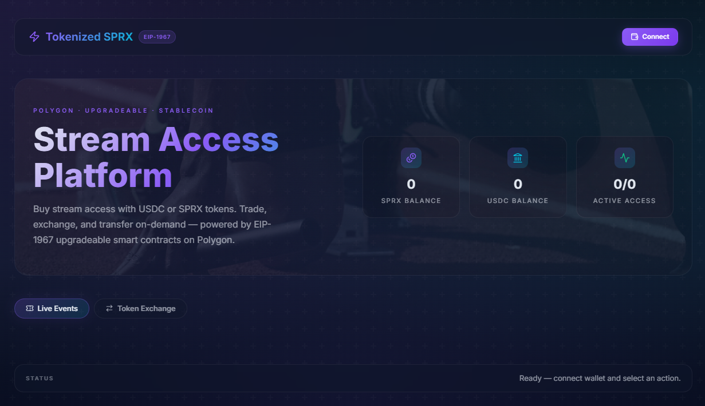

<div align="center">
  
  <h1>Tokenized SPRX</h1>
  <p><strong>Decentralized AR/VR Sports Streaming Platform on Polygon</strong></p>
  <p>
    
    
    
    
    
  </p>
</div>

---

## Overview

Tokenized SPRX is a decentralized platform that combines **real-time sports streaming** with **blockchain-enabled access control and monetization**. Users pay for stream access by burning SPRX tokens or paying USDC, with on-chain NFT tickets for event entry — all powered by upgradeable EIP-1967 transparent proxy smart contracts deployed on Polygon.

The stack is composed of three layers:
- **Smart Contracts** — Hardhat + OpenZeppelin upgradeable contracts (Transparent Proxy, AccessControl, Pausable)
- **Backend** — Node.js / Express server handling off-chain event metadata and on-chain access verification
- **Frontend DApp** — React 19 + Vite 7, RainbowKit wallet connection, dark glassmorphism UI with live sport thumbnails

---

## UI Preview

> Dark glassmorphism theme with stadium hero background, live sport event cards with per-event thumbnails, token exchange, and real-time balance display.


**Key UI elements:**
- Single wallet connect button (top-right) — shows account name when connected
- Hero section with SPRX / USDC / Active Access stat cards
- Live Events tab — event cards with sport-specific photo banners and pulsing **LIVE** badge
- Token Exchange tab — buy / sell SPRX for USDC at the on-chain rate
- Status bar — real-time feedback on every transaction

---

## Folder Structure

```
tokenized_sprx/
├── Contract/                  # Hardhat project
│   ├── contracts/
│   │   ├── StreamToken.sol         # ERC-20 SPRX token (upgradeable)
│   │   ├── TokenizedAccess.sol     # ERC-721 NFT ticket (upgradeable)
│   │   └── StreamAccessController.sol  # Access + exchange controller (upgradeable)
│   ├── scripts/
│   │   └── deploy.js               # Transparent proxy deployment
│   ├── test/
│   │   └── Lock.js                 # 6 integration tests
│   └── hardhat.config.js
│
├── Frontend/                  # React + Vite DApp
│   ├── src/
│   │   ├── App.tsx                 # Main app component
│   │   ├── main.tsx                # RainbowKit / wagmi providers
│   │   ├── wallet.ts               # Chain config (Polygon / Amoy)
│   │   ├── App.css                 # Glassmorphism styles
│   │   └── index.css               # Global theme variables
│   ├── files/
│   │   └── SPRX.png               # Project logo
│   ├── .env.example
│   └── vite.config.ts
│
├── Server/                    # Node.js / Express backend
│   ├── src/
│   │   └── server.js               # API routes + on-chain verification
│   └── package.json
│
└── README.md
```

---

## Technology Stack

| Layer | Technology |
|-------|------------|
| **Smart Contracts** | Solidity 0.8.28, Hardhat 2.27, OpenZeppelin Upgradeable v5.1, EIP-1967 Transparent Proxy |
| **Frontend DApp** | React 19, Vite 7, ethers.js 6, RainbowKit 2, wagmi 2, lucide-react |
| **Backend Server** | Node.js, Express 4, ethers.js 6, dotenv, cors |
| **Networks** | Polygon Mainnet (chainId 137), Amoy Testnet (chainId 80002) |
| **Stablecoin** | USDC — `0x3c499c542cEF5E3811e1192ce70d8cC03d5c3359` (Polygon) |

---

## Smart Contract Architecture

All three contracts use the **EIP-1967 Transparent Proxy** pattern via `@openzeppelin/hardhat-upgrades`. Each contract:
- Has `_disableInitializers()` in its constructor (implementation protection)
- Uses `AccessControlUpgradeable` for role-based permissions
- Uses `PausableUpgradeable` for emergency stops
- Is safe to upgrade via `upgrades.upgradeProxy()`

### StreamToken.sol — SPRX ERC-20 Token

```
Roles:
  DEFAULT_ADMIN_ROLE  — full control, initial supply recipient
  PAUSER_ROLE         — pause / unpause transfers
  MINTER_ROLE         — mint new SPRX (granted to StreamAccessController)

Key functions:
  initialize(name, symbol, initialSupply, defaultAdmin)
  mint(to, amount)              — MINTER_ROLE only
  mintRewards(to, amount)       — DEFAULT_ADMIN_ROLE only
  setMinter(account, allowed)   — manage minter grants
  pause() / unpause()
```

### TokenizedAccess.sol — NFT Event Ticket (ERC-721)

```
Roles:
  DEFAULT_ADMIN_ROLE  — admin, royalty configuration
  PAUSER_ROLE         — pause transfers
  MINTER_ROLE         — mint tickets (granted to controller or admin)

Storage:
  TicketData { eventId, accessLevel, seat }  per tokenId
  _eventBalances[eventId][address]           ticket count per wallet

Key functions:
  initialize(name, symbol, royaltyReceiver, royaltyFeeNumerator, defaultAdmin)
  mintTicket(to, eventId, accessLevel, seat, uri)   — MINTER_ROLE only
  hasTicketForEvent(owner, eventId) view returns (bool)
  setDefaultRoyalty(receiver, feeNumerator)
```

### StreamAccessController.sol — Access + USDC Exchange

```
Roles:
  DEFAULT_ADMIN_ROLE  — configuration, fee withdrawal
  PAUSER_ROLE         — emergency pause
  OPERATOR_ROLE       — operational adjustments

State:
  sprxPerStable        — SPRX minted per 1 USDC (e.g. 100)
  stableCostPerMinute  — USDC cost per access minute (6-decimal)
  feeBps               — protocol fee in basis points (e.g. 100 = 1%)
  accumulatedFees      — collected protocol fees

Key functions:
  initialize(streamToken, ticketContract, stablecoin,
             sprxPerStable, stableCostPerMinute, feeBps, defaultAdmin)
  burnForAccess(eventId, accessMinutes, burnAmount)   — burn SPRX for access
  payStableForAccess(eventId, accessMinutes)          — pay USDC for access
  buyTokens(stableAmount)                             — swap USDC → SPRX
  sellTokens(sprxAmount)                              — swap SPRX → USDC
  hasAccess(user, eventId) view returns (bool)
  withdrawFees(to)                                    — DEFAULT_ADMIN_ROLE
  setRates(sprxPerStable, stableCostPerMinute, feeBps)
```

**Manual reentrancy guard** (`uint256 private _locked`) is used instead of `ReentrancyGuardUpgradeable` for compatibility with OpenZeppelin v5.

---

## Backend API Reference

Base URL: `http://localhost:5000`

| Method | Endpoint | Description | Body / Params |
|--------|----------|-------------|---------------|
| `GET` | `/api/events` | Returns all event metadata | — |
| `GET` | `/api/exchange/rate` | On-chain SPRX/USDC rate from contract | — |
| `POST` | `/api/ticket/verify` | Check if wallet holds an NFT for an event | `{ wallet, eventId }` |
| `POST` | `/api/stream/start` | Verify on-chain access and return session ID | `{ wallet, eventId }` |
| `POST` | `/api/stream/end` | Close a streaming session | `{ sessionId }` |

**Example — Start Stream:**
```json
POST /api/stream/start
{ "wallet": "0xABC...", "eventId": 1 }

→ 200  { "sessionId": "uuid", "eventId": 1, "wallet": "0xABC...", "status": "active" }
→ 403  { "message": "Access denied." }
```

---

## Setup Guide

### Prerequisites
- Node.js >= 18.x
- MetaMask or any EIP-1193 compatible wallet
- Polygon Amoy testnet funds (for deployment) — [faucet](https://faucet.polygon.technology/)
- WalletConnect Project ID — [cloud.walletconnect.com](https://cloud.walletconnect.com)

---

### 1. Clone the Repository

```bash
git clone https://github.com/<your-username>/tokenized_sprx.git
cd tokenized_sprx
```

---

### 2. Smart Contracts

```bash
cd Contract
npm install
```

Create `Contract/.env`:
```env
PRIVATE_KEY=<your-deployer-private-key>
POLYGON_RPC_URL=https://polygon-rpc.com
AMOY_RPC_URL=https://rpc-amoy.polygon.technology
```

Compile and run tests:
```bash
npx hardhat compile
npx hardhat test
```

Deploy to Amoy testnet:
```bash
npx hardhat run scripts/deploy.js --network amoy
```

The deploy script will print the proxy addresses for all three contracts — copy them to frontend and server `.env` files.

---

### 3. Backend Server

```bash
cd Server
npm install
```

Create `Server/.env`:
```env
PORT=5000
RPC_URL=https://rpc-amoy.polygon.technology
TICKET_ADDRESS=<TokenizedAccess proxy address>
ACCESS_ADDRESS=<StreamAccessController proxy address>
```

Start the server:
```bash
node src/server.js
```

Server runs at `http://localhost:5000`.

---

### 4. Frontend DApp

```bash
cd Frontend
npm install
```

Copy and fill in the environment file:
```bash
cp .env.example .env
```

`Frontend/.env`:
```env
VITE_APP_BACKEND_URL=http://localhost:5000
VITE_APP_TICKET_ADDRESS=<TokenizedAccess proxy address>
VITE_APP_TOKEN_ADDRESS=<StreamToken proxy address>
VITE_APP_ACCESS_ADDRESS=<StreamAccessController proxy address>
VITE_APP_CHAIN_ID=80002
VITE_APP_WALLETCONNECT_PROJECT_ID=<your-walletconnect-project-id>
```

Run the dev server:
```bash
npm run dev
```

Frontend runs at `http://localhost:5173`.

---

## Development Workflow

1. Write / modify contracts in `Contract/contracts/`
2. Run `npx hardhat test` — all 6 tests must pass
3. Deploy with `npx hardhat run scripts/deploy.js --network amoy`
4. Update proxy addresses in `Server/.env` and `Frontend/.env`
5. Start backend: `node src/server.js`
6. Start frontend: `npm run dev`
7. Connect wallet, switch to Amoy, and test the full flow

---

## Contract Upgrade Flow

Because the transparent proxy pattern is used, upgrades don't change the proxy address:

```bash
# Edit the contract, then:
npx hardhat run scripts/upgrade.js --network amoy
# Proxy address stays the same — no frontend config change needed
```

---

## Future Enhancements

- Full AR/VR integration using Unity or WebXR
- IPFS / Livepeer decentralized content delivery
- Layer-2 scaling (Arbitrum / Base) for lower fees
- DAO governance for event curation and fee allocation
- Reward system for active viewer participation
- Socket.io real-time session heartbeat

---

## License

This project is released under the **MIT License**.

---

## Author

**Tokenized SPRX**  
Developed by [YSandy13869]  
© 2026, All rights reserved.
